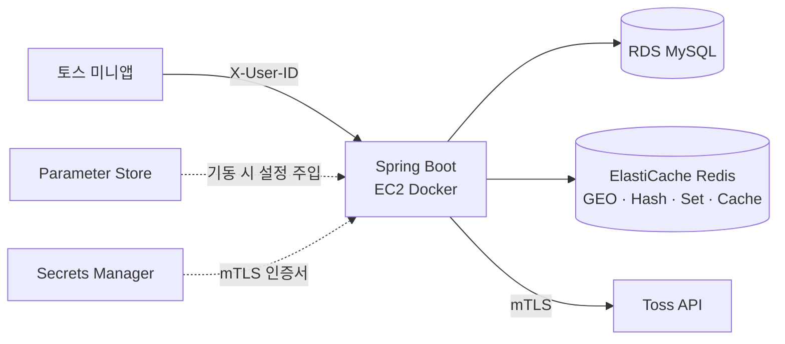

# Subway Worker Server

[](https://github.com/sharonita610/subway-worker-server/actions/workflows/test.yml)

출퇴근길 위치를 기반으로 동료를 포획하고 성장시키는 수집형 게임의 백엔드입니다. 토스 미니앱으로 운영했으며 현재는 운영을 종료했습니다.

## 기술 스택

- Java 17, Spring Boot 3.3, Spring Security, Spring Data JPA (MySQL), Spring Data Redis
- springdoc OpenAPI, Lombok, JUnit 5 + Mockito, Gradle
- 운영 당시 인프라: AWS EC2 · RDS · ElastiCache · ECR, Parameter Store, Secrets Manager, GitHub Actions

## 핵심 기능

| 영역 | 내용 |
|---|---|
| GPS | 사용자 주변 3×3 grid에 동료·선물상자를 생성하고(Redis GEO, grid 단위 락) 반경 1km 안을 조회 |
| 포획 · 트랩 | 도구 확률 × 동료 레벨 확률로 판정. 트랩은 스케줄러가 매시 반경 안의 동료를 포획 처리 |
| 성장 | 동료 강화, 스킬카드 강화, 스테이지 · 던전 클리어 보상 |
| 경제 | 동료 · 스킬카드 장터, 가챠, 상점, 구독 · 출석 보상 메일 |
| 인증 | 토스 로그인(mTLS) 후 발급한 UUID를 `X-User-ID` 헤더로 전달 |

API 62개, 테스트 181개.

## 아키텍처



- **MySQL**은 사용자 · 동료 · 스킬카드 · 장터 · 기록처럼 남아야 하는 상태를, **Redis**는 수명이 짧은 위치 데이터를 맡습니다. 동료 위치는 GEO, 동료 속성은 Hash(TTL 1시간), 사용자별 획득 기록은 Set, 사용자 정보 조회는 Redis Cache입니다.
- 설정값은 기동 시 `spring.config.import`로 Parameter Store에서 읽고, 토스 mTLS 인증서는 Secrets Manager에서 가져옵니다. 저장소에는 플레이스홀더만 있습니다.
- 트랩 포획 확인과 구독 보상 지급은 애플리케이션 안의 스케줄러가 돌립니다.

## 구조

```
controller/      컨트롤러 (요청 바인딩과 응답 반환만)
dto/             request · response DTO (도메인별 패키지). controller와 service가 함께 사용
service/
  common/        UserFinder, UserLevelProcessor, RewardProcessor (모든 도메인이 공유)
  user coworker skill market gacha gps stage store system
domain/          enum으로 표현한 게임 규칙 (확률표, 보상표, 레벨표)
entity/ repository/   JPA
config/          Security (X-User-ID 필터, 공개 경로 목록), Swagger, Redis, JPA Auditing
```

계층은 `controller → service → repository`로만 흐르고, service는 controller를 모릅니다. service 안에서는 `common ← 각 도메인`, `coworker ← user · market · stage`, `skill ← market`으로 한 방향이며 순환이 없습니다. 이 규칙은 `ArchitectureTest`(ArchUnit)가 검사합니다.

## 실행

```bash
./gradlew test       # 단위 · 슬라이스 · 아키텍처 테스트 181개
./gradlew bootRun    # MySQL, Redis 필요
```

로컬 실행에 필요한 환경변수: `LOCALHOST_USER`, `LOCAL_DB_PASSWORD`, `REDIS_HOST`

Swagger UI는 `http://localhost:8080/swagger-ui.html` 에서 열리며, Authorize 버튼에 `X-User-ID` 값을 넣으면 보호된 API를 호출할 수 있습니다.

## CI/CD

```
GitHub Actions ─ Gradle build ─ Docker build ─ ECR push ─ (수동 승인) ─ SSH ─ EC2 docker run
```

- **이미지 빌드**: `prod-image-deploy`가 JAR을 빌드해 Docker 이미지로 만들고 ECR에 `latest`와 고유 태그로 올립니다.
- **테스트**: `test` 워크플로가 main push와 PR마다 `./gradlew test`를 실행합니다. 이미지 빌드도 테스트를 통과해야 진행됩니다.
- **배포**: `prod-deploy`를 이미지 태그를 지정해 수동 실행하면 EC2에 SSH로 접속해 ECR에서 pull, 기존 컨테이너 교체, `--restart unless-stopped`로 기동합니다. DB 비밀번호는 EC2가 Parameter Store에서 직접 읽어 환경변수로 넘기므로 GitHub에는 저장하지 않습니다.
- **dev**: `dev-cicd_workflow`가 빌드부터 dev EC2 배포까지 한 번에 수행합니다.
- 빌드와 배포를 분리한 이유는 같은 이미지를 태그로 골라 재배포하거나 되돌리기 위해서입니다. 운영 종료 후 세 워크플로 모두 수동 트리거로 바꿔 두었습니다.

## 테스트 전략

- **확률 로직은 통계 테스트로 검증**합니다. 경계값(항상 성공 · 항상 실패)은 정확히, 확률은 1만 회 표본이 기대값 ±3%p 안에 들어오는지 확인합니다.
- **응답 형식은 스냅샷으로 고정**합니다. `DtoJsonShapeTest`가 모든 DTO record를 직렬화한 JSON 키 구조를 `src/test/resources/dto-json-shapes.txt`와 비교해, 응답 키가 바뀌면 테스트가 먼저 실패합니다.
